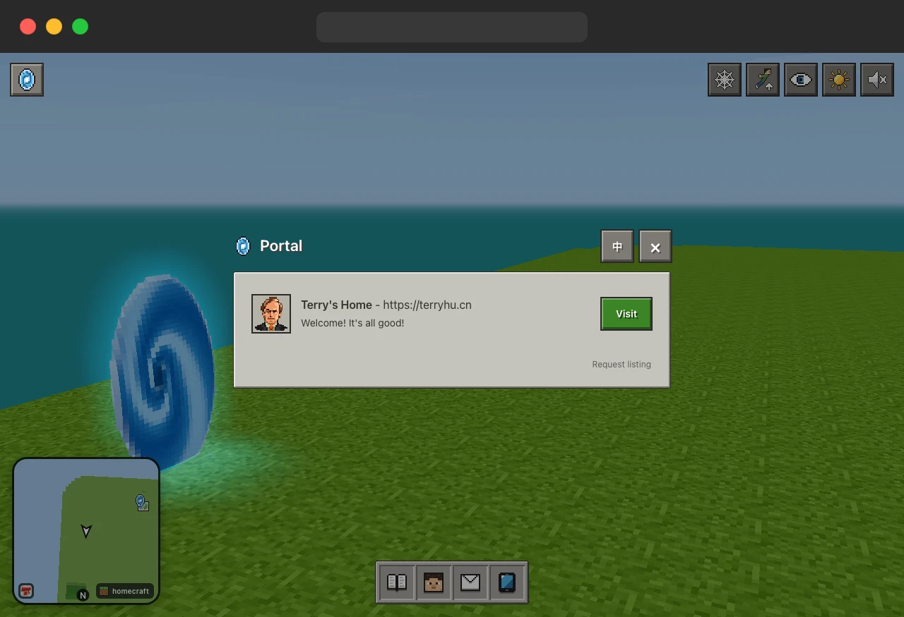

# Homecraft

[中文](README.md) · **English**

## Homepage + Minecraft = Homecraft

I've always enjoyed building and customizing websites, but even after trying one template after another, I still felt constrained.

Inspired by Minecraft, The Matrix and the metaverse, I used AI to turn my personal website from a 2D page into a 3D world.

You can explore it freely. I've built a basketball court, a gym and a workbench, and added a day–night cycle and a weather system.

You can also embed regular web pages and open them by pressing F. The block-based graphics keep rendering demands low, so the site works on phones too.

Exploring the site feels like visiting a friend's home. Compared with a traditional website, it may be a more memorable way to get to know someone.

Once you get used to this kind of personal website, it's hard to go back…

## Screenshots [🔗 Terry's Home](https://terryhu.cn)

| Basketball court | Pool | Workbench |
| :---: | :---: | :---: |
|  |  |  |
| **Projects** | **Gym** | **Weather** |
|  |  |  |

## Getting started

The project includes a starter template, AI prompts and project guidelines. Fork the repository and start vibe coding your own world.

Run `python3 tools/serve.py` in the project folder. The script finds an available port and opens the site in your browser.

The full source of Terry's Home is in [examples/terry-home](examples/terry-home).

## Portal [🔗 Request listing](https://github.com/terryHu7/homecraft/issues/new/choose)

The portal lists personal websites and lets visitors travel between them, much like links between blogs.

## Links [🔗 LINUX DO](https://linux.do)
