# Homecraft

[中文](README.md) · **English**

## Homepage + Minecraft = Homecraft

I've always enjoyed building and customizing websites, but even after trying one template after another, I still felt constrained.

Inspired by Minecraft, The Matrix and the metaverse, I used AI to turn my personal website from a 2D page into a 3D world.

You can explore it freely. I've built a basketball court, a gym and a workbench, and added a day–night cycle and a weather system.

You can also embed regular web pages and open them by pressing F. The block-based graphics keep rendering demands low, so the site works on phones too. Press P or tap the phone's Camera app to open the Photo Studio: pick 16:9/9:16/1:1 ratios, fine-tune lighting and weather, frame an in-world selfie, and export crisp screenshots to share.

Exploring the site feels like visiting a friend's home. Compared with a traditional website, it may be a more memorable way to get to know someone.

Once you get used to this kind of personal website, it's hard to go back…

## Screenshots [🔗 Terry's Home](https://terryhu.cn)

| Basketball court | Pool | Workbench |
| :---: | :---: | :---: |
|  |  |  |
| **Projects** | **Gym** | **Weather** |
|  |  |  |

## Getting started

Run `python3 tools/serve.py` to start the site. The project includes a starter template, AI prompts, and project guidelines.

The full source of Terry's Home is in [examples/terry-home](examples/terry-home).

For future updates, see the [update guide](engine/UPDATING.md).

## Portal [🔗 Request listing](https://github.com/terryHu7/homecraft/issues/new/choose)

The portal lists personal websites and lets visitors travel between them, much like links between blogs.

| [terryhu.cn](https://terryhu.cn) | [heikeji.com](https://heikeji.com) | [zhaur.com](https://zhaur.com) |
| :---: | :---: | :---: |
| <a href="https://terryhu.cn">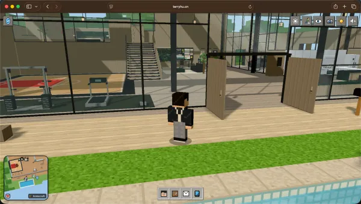</a> | <a href="https://heikeji.com">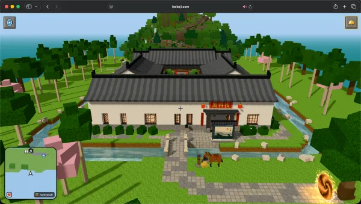</a> | <a href="https://zhaur.com">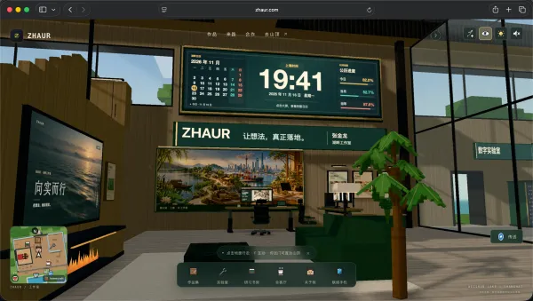</a> |
| [rsliyu.com](https://rsliyu.com) | [m.134688.xyz](https://m.134688.xyz/) | [home.aihot.kdns.fr](https://home.aihot.kdns.fr/) |
| <a href="https://rsliyu.com">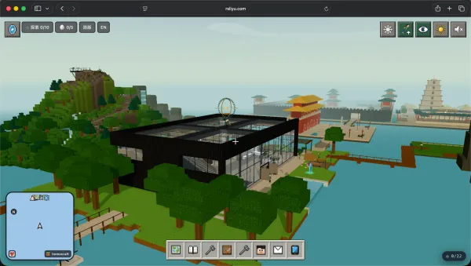</a> | <a href="https://m.134688.xyz/">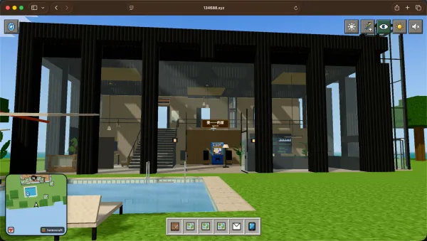</a> | <a href="https://home.aihot.kdns.fr/">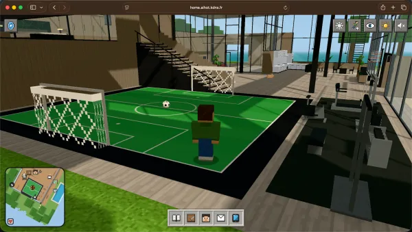</a> |
| [xinglong.tech](https://xinglong.tech/) | [xiaoshi.ond6.com](https://xiaoshi.ond6.com/) | [home.sinmu.xyz](https://home.sinmu.xyz) |
| <a href="https://xinglong.tech/">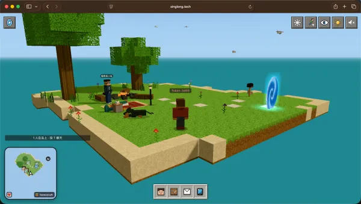</a> | <a href="https://xiaoshi.ond6.com/">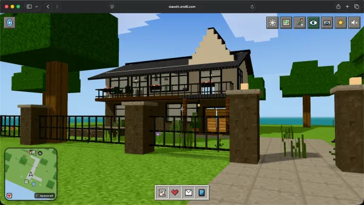</a> | <a href="https://home.sinmu.xyz">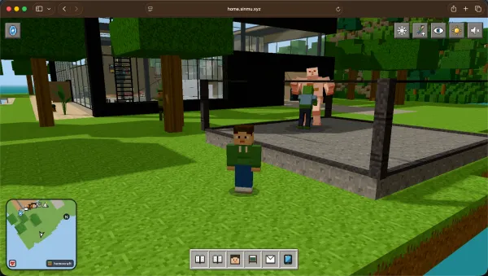</a> |
| [home.m.1game.fun](https://home.m.1game.fun:4443/) | [hbljx.github.io](https://hbljx.github.io/) | [blog.bwcxbk.com](https://blog.bwcxbk.com/) |
| <a href="https://home.m.1game.fun:4443/">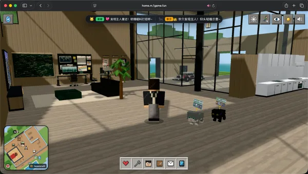</a> | <a href="https://hbljx.github.io/">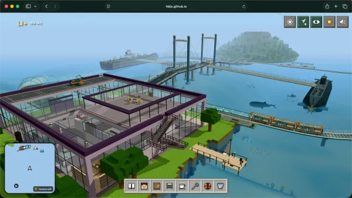</a> | <a href="https://blog.bwcxbk.com/">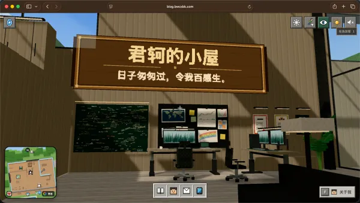</a> |
| [murphy.red](https://www.murphy.red/world) | [wyc21.com](https://www.wyc21.com/) | [kidsseeghosts.art](https://kidsseeghosts.art/) |
| <a href="https://www.murphy.red/world">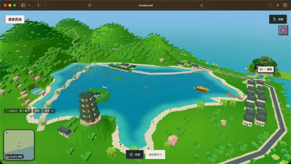</a> | <a href="https://www.wyc21.com/">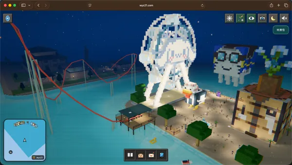</a> | <a href="https://kidsseeghosts.art/">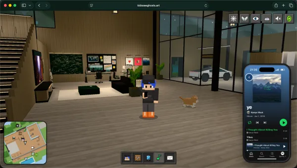</a> |
| [cailgainey.us.ci](https://cailgainey.us.ci) | [gdg.nith.ac.in](https://gdg.nith.ac.in/labyrinth/) | |
| <a href="https://cailgainey.us.ci">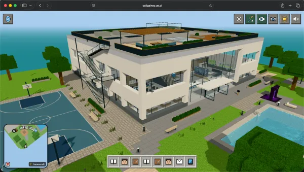</a> | <a href="https://gdg.nith.ac.in/labyrinth/">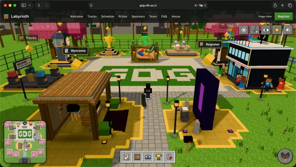</a> | |

## Buy Me a Coffee

  
  &nbsp;&nbsp;&nbsp;&nbsp;
  

  PayPal / Ko-fi &nbsp;&nbsp;&nbsp;&nbsp;&nbsp;&nbsp;&nbsp;&nbsp;&nbsp;&nbsp;&nbsp;&nbsp;&nbsp;&nbsp;&nbsp;&nbsp;&nbsp;&nbsp;&nbsp;&nbsp; Card / Apple Pay

## Links [🔗 LINUX DO](https://linux.do)
