# Homecraft

**中文** · [English](README.en.md)

## 个人网站即我的世界

过去我是个喜欢折腾网站的人，但模板换了又换，总感觉被什么东西困住了。

受我的世界、黑客帝国和元宇宙的启发，借助 AI，我把个人网站从二维网页建成了三维世界。

这个世界包罗万象，可以自由移动，里面建了篮球场，健身房，工作台，甚至还有昼夜交替和天气系统。

对于二维网页也完全可以内嵌进来，例如按 F 查看。而且得益于方块风的性能开销小，手机也能轻松访问。还可以随时按下 P 键或打开手机相机，自由调节画幅、光影、天气和自拍机位，截取高清图片一键分享。

逛上一圈，像是去朋友家做客了一趟。比起传统的网站，这样的相识或许更让人印象深刻。

一旦接受了这个设定，就再也回不去传统个人网站了…

## 实机截图 [🔗 Terry's Home](https://terryhu.cn)

| 篮球场 | 泳池 | 工作台 |
| :---: | :---: | :---: |
|  |  |  |
| **作品展示** | **健身房** | **天气系统** |
|  |  |  |

## 开始使用

一行命令 `python3 tools/serve.py`即可运行。项目已内置初始模板、相关提示词与约束。

Terry's Home 完整实现见 [examples/terry-home](examples/terry-home)。

后续更新见[更新指引](engine/UPDATING.md)。

## 传送门 [🔗 申请收录](https://github.com/terryHu7/homecraft/issues/new/choose)

类似传统博客的友链，传送门列表收录了大家的个人网站，方便互相"串门"。

| [terryhu.cn](https://terryhu.cn) | [heikeji.com](https://heikeji.com) | [zhaur.com](https://zhaur.com) |
| :---: | :---: | :---: |
| <a href="https://terryhu.cn">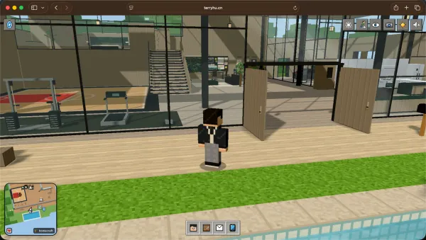</a> | <a href="https://heikeji.com">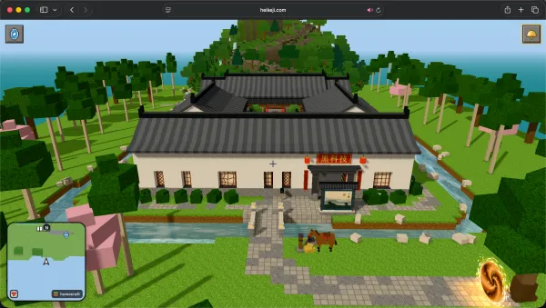</a> | <a href="https://zhaur.com">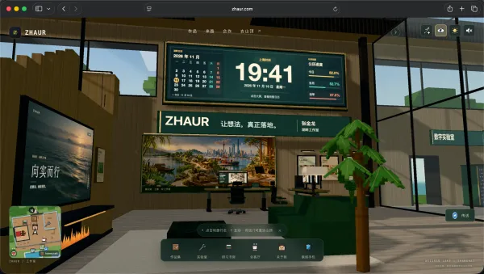</a> |
| [rsliyu.com](https://rsliyu.com) | [m.134688.xyz](https://m.134688.xyz/) | [home.aihot.kdns.fr](https://home.aihot.kdns.fr/) |
| <a href="https://rsliyu.com">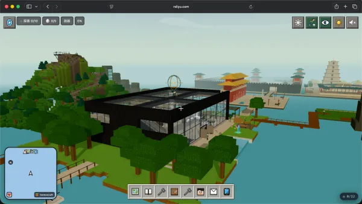</a> | <a href="https://m.134688.xyz/">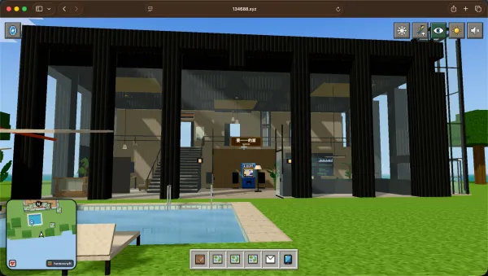</a> | <a href="https://home.aihot.kdns.fr/">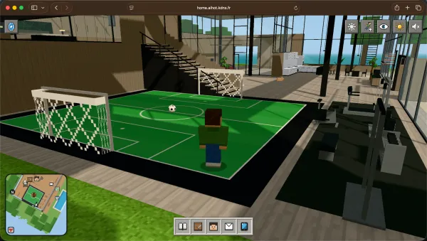</a> |
| [xinglong.tech](https://xinglong.tech/) | [xiaoshi.ond6.com](https://xiaoshi.ond6.com/) | [home.sinmu.xyz](https://home.sinmu.xyz) |
| <a href="https://xinglong.tech/">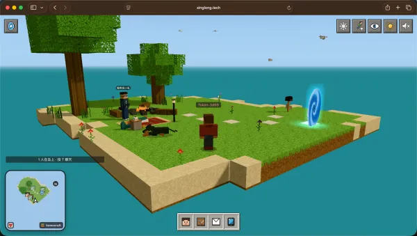</a> | <a href="https://xiaoshi.ond6.com/">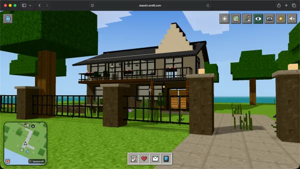</a> | <a href="https://home.sinmu.xyz">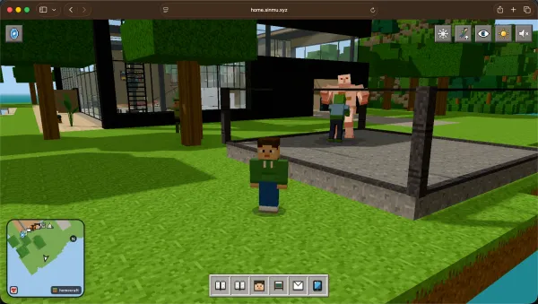</a> |
| [home.m.1game.fun](https://home.m.1game.fun:4443/) | [hbljx.github.io](https://hbljx.github.io/) | [blog.bwcxbk.com](https://blog.bwcxbk.com/) |
| <a href="https://home.m.1game.fun:4443/">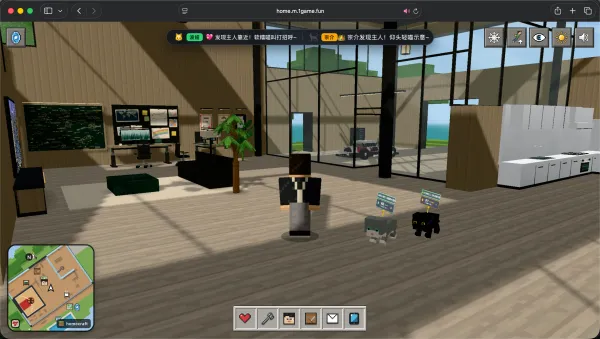</a> | <a href="https://hbljx.github.io/">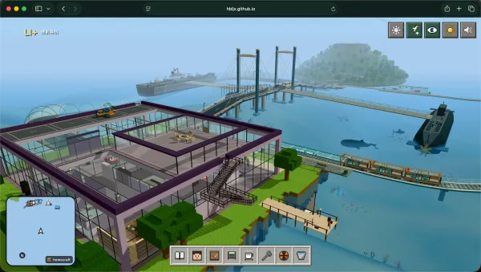</a> | <a href="https://blog.bwcxbk.com/">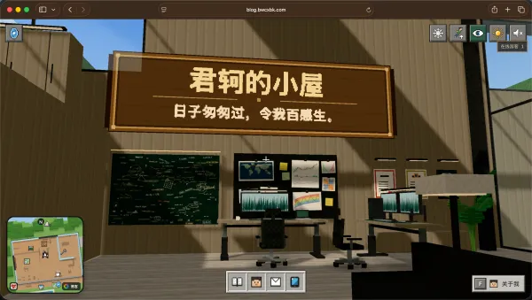</a> |
| [murphy.red](https://www.murphy.red/world) | [wyc21.com](https://www.wyc21.com/) | [kidsseeghosts.art](https://kidsseeghosts.art/) |
| <a href="https://www.murphy.red/world">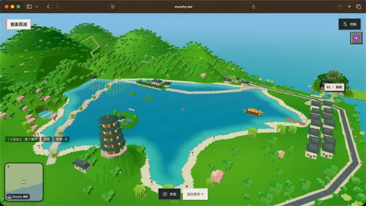</a> | <a href="https://www.wyc21.com/">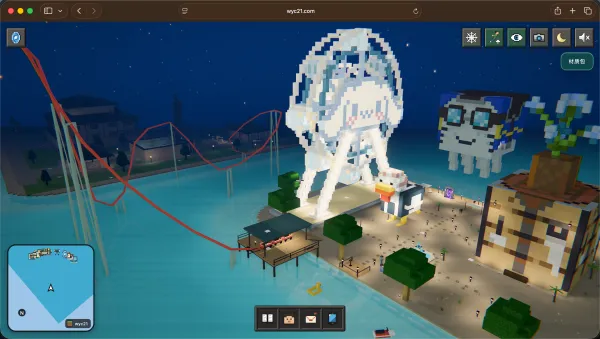</a> | <a href="https://kidsseeghosts.art/">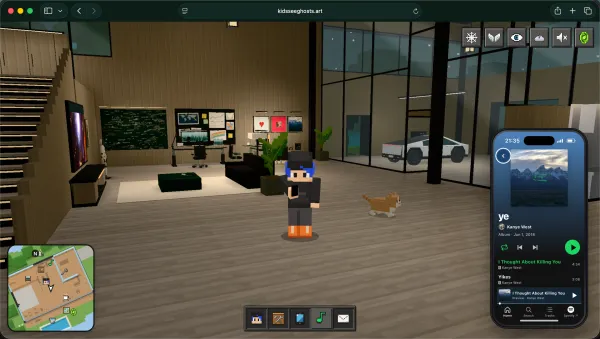</a> |
| [cailgainey.us.ci](https://cailgainey.us.ci) | [gdg.nith.ac.in](https://gdg.nith.ac.in/labyrinth/) | |
| <a href="https://cailgainey.us.ci">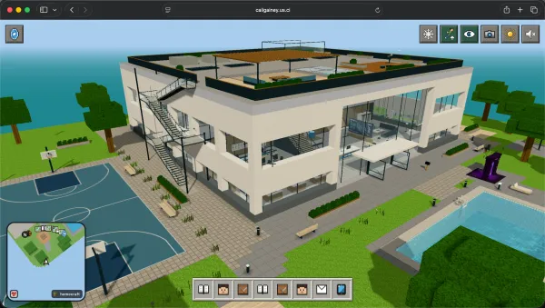</a> | <a href="https://gdg.nith.ac.in/labyrinth/">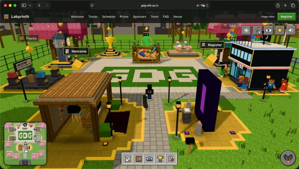</a> | |

扫码加入 Homecraft 俱乐部:

## 微信赞赏码

  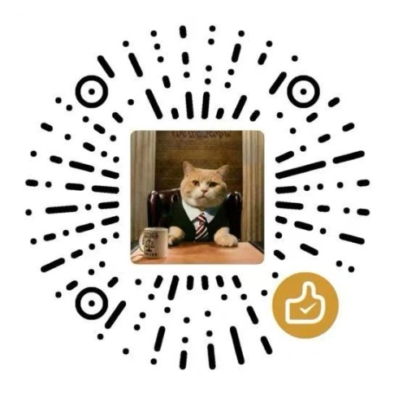

## 友情链接 [🔗 LINUX DO](https://linux.do)
